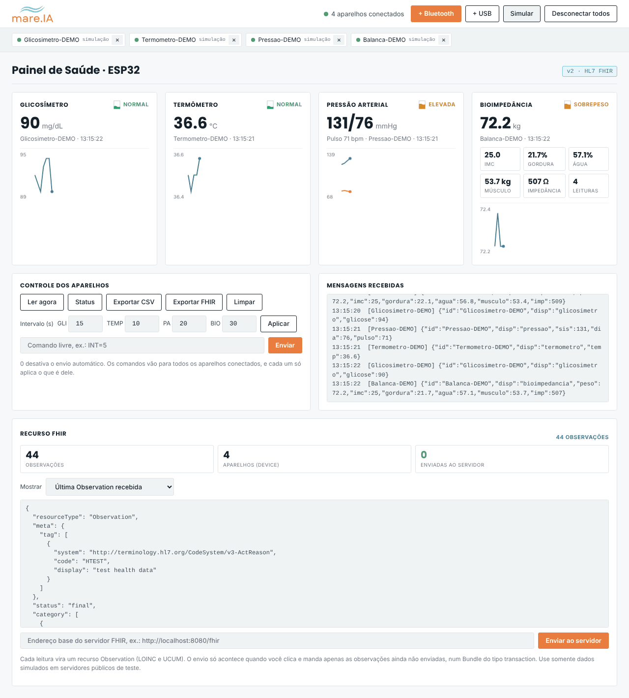
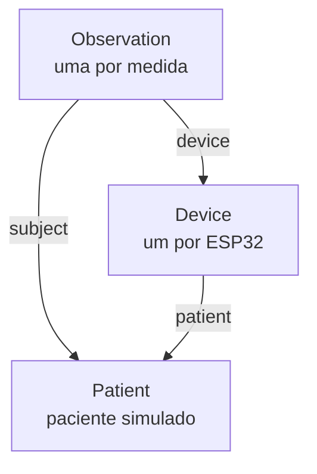

# Emulador IoT de Saúde com HL7 FHIR

Simulador de dispositivos de saúde conectados, feito com ESP32, que envia leituras por Bluetooth Low Energy (BLE) ou USB para um painel web. O painel converte cada leitura para o padrão **HL7 FHIR**, mostra os recursos gerados, exporta um Bundle em JSON e, se você quiser, envia os dados para um servidor FHIR.

O projeto serve para ensino, pesquisa e testes de integração em saúde digital, sem depender de aparelhos médicos reais.

> **Aviso:** todos os dados são simulados. Este projeto não é um dispositivo médico e não deve ser usado para diagnóstico, tratamento ou acompanhamento de pacientes reais.



## Sumário

* [O que o simulador faz](#o-que-o-simulador-faz)
* [Estrutura do repositório](#estrutura-do-repositório)
* [Hardware e software necessários](#hardware-e-software-necessários)
* [Como gravar os ESP32](#como-gravar-os-esp32)
* [Como usar o painel](#como-usar-o-painel)
* [Protocolo BLE dos aparelhos](#protocolo-ble-dos-aparelhos)
* [HL7 FHIR aplicado ao projeto](#hl7-fhir-aplicado-ao-projeto)
* [Testando com um servidor FHIR](#testando-com-um-servidor-fhir)
* [Limitações e próximos passos](#limitações-e-próximos-passos)

## O que o simulador faz

Quatro aparelhos de saúde são emulados, cada um num ESP32 diferente:

| Aparelho | Medidas | Intervalo padrão |
|---|---|---|
| Glicosímetro | glicose (mg/dL), com picos ocasionais | 15 s |
| Termômetro | temperatura corporal (°C), com febre ocasional | 10 s |
| Medidor de pressão | pressão sistólica, diastólica (mmHg) e pulso (bpm) | 20 s |
| Balança de bioimpedância | peso, IMC, gordura, água, massa muscular e impedância | 30 s |

Os valores variam aos poucos, como medidas reais, e de vez em quando saem da faixa normal para testar alertas. Também existe um firmware `todos` que roda os quatro aparelhos numa única placa.

O painel (`interface/painel_saude.html`) roda direto no Chrome ou no Edge, sem instalação. Ele:

* conecta vários aparelhos ao mesmo tempo por Web Bluetooth ou Web Serial;
* mostra o valor atual, a classificação (normal, elevada, febre…) e um gráfico de cada medida;
* envia comandos aos aparelhos (ler agora, mudar o intervalo);
* exporta as leituras em CSV e em **FHIR (Bundle JSON)**;
* envia os recursos FHIR para um servidor, quando você clica;
* tem um modo **Simular**, que cria aparelhos virtuais para testar sem nenhuma placa.

## Estrutura do repositório

```
.
├── platformio.ini        um ambiente de compilação por aparelho
├── gravar.sh             grava as placas uma por vez (macOS)
├── include/
│   └── ble_saude.h       base comum: BLE, comandos e envio
├── src/
│   ├── glicosimetro.cpp
│   ├── termometro.cpp
│   ├── pressao.cpp
│   ├── bioimpedancia.cpp
│   └── todos.cpp         os quatro aparelhos numa única placa
├── interface/
│   └── painel_saude.html painel web com a conversão FHIR
└── docs/
    └── painel.png
```

## Hardware e software necessários

* ESP32 DevKit V1 (30 pinos): uma placa por aparelho, ou só uma com o ambiente `todos`.
* Cabo USB de dados e o driver da ponte USB serial da placa (CP210x ou CH340).
* [VS Code](https://code.visualstudio.com/) com a extensão [PlatformIO](https://platformio.org/).
* Google Chrome ou Microsoft Edge no computador, que têm Web Bluetooth e Web Serial. Safari e Firefox não têm.

## Como gravar os ESP32

Com o PlatformIO instalado, abra a pasta do projeto no VS Code uma vez e depois rode:

```bash
./gravar.sh                      # grava os quatro aparelhos, um de cada vez
./gravar.sh termometro pressao   # grava só os escolhidos
```

O script compila tudo, pede para você conectar uma placa de cada vez e mostra o nome BLE gravado (ex.: `Termometro-A1B2`). O sufixo vem do endereço MAC, então é possível ter vários aparelhos do mesmo tipo.

Para gravar manualmente, escolha o ambiente:

```bash
pio run -e glicosimetro -t upload --upload-port /dev/cu.usbserial-XXXX
```

Ambientes disponíveis: `glicosimetro`, `termometro`, `pressao`, `bioimpedancia` e `todos`.

## Como usar o painel

1. Abra `interface/painel_saude.html` no Chrome ou no Edge.
2. Clique em **+ Bluetooth** uma vez para cada ESP32, ou em **+ USB** para uma placa no cabo. Para testar sem placas, clique em **Simular**.
3. As leituras aparecem nos cards, e o card **Recurso FHIR** mostra os recursos gerados.
4. Use **Exportar FHIR** para salvar o Bundle, ou informe o endereço de um servidor e clique em **Enviar ao servidor**.

Se o navegador bloquear o envio ao servidor por causa da origem `file://`, sirva o painel localmente:

```bash
cd interface
python3 -m http.server 8000
# acesse http://localhost:8000/painel_saude.html
```

## Protocolo BLE dos aparelhos

Cada ESP32 usa o serviço **Nordic UART Service (NUS)**:

| Função | UUID |
|---|---|
| Serviço | `6E400001-B5A3-F393-E0A9-E50E24DCCA9E` |
| RX (o painel escreve comandos) | `6E400002-B5A3-F393-E0A9-E50E24DCCA9E` |
| TX (o ESP32 notifica os dados) | `6E400003-B5A3-F393-E0A9-E50E24DCCA9E` |

Cada mensagem é uma linha JSON terminada em `\n`, dividida em pedaços do tamanho do MTU negociado (até 185 bytes).

**Leituras:**

```json
{"id":"Glicosimetro-A1B2","disp":"glicosimetro","glicose":96,"un":"mg/dL","t":120}
{"id":"Termometro-C3D4","disp":"termometro","temp":36.6,"un":"C","t":95}
{"id":"Pressao-E5F6","disp":"pressao","sis":118,"dia":77,"pulso":72,"un":"mmHg","t":60}
{"id":"Balanca-0A1B","disp":"bioimpedancia","peso":72.0,"imc":24.9,"gordura":21.5,"agua":57.3,"musculo":53.9,"imp":506,"t":30}
```

O campo `t` são os segundos desde que a placa ligou.

**Resposta ao `STATUS`** (novidade da versão 2, usada para montar o recurso Device):

```json
{"id":"Glicosimetro-A1B2","intervalos_s":{"GLI":15},"fw":"2.0.0-fhir","modelo":"ESP32 DevKit V1 (emulador)"}
```

**Comandos** (pelo painel, por um app BLE como nRF Connect, ou pelo Monitor Serial a 115200):

| Comando | Efeito |
|---|---|
| `LER` | envia uma leitura agora |
| `STATUS` | informa intervalo, versão do firmware e modelo |
| `INT=10` | muda o intervalo para 10 s |
| `GLI=10`, `TEMP=5`, `PA=20`, `BIO=30` | muda o intervalo só do aparelho daquele tipo |
| `GLI=0` (ou outro tipo) | desliga o envio automático |

Um aparelho ignora comandos de outro tipo, por isso o painel pode mandar o mesmo comando para todos.

## HL7 FHIR aplicado ao projeto

O [HL7 FHIR](https://hl7.org/fhir/R4/) (*Fast Healthcare Interoperability Resources*) é o padrão internacional para troca de dados de saúde. Ele organiza a informação em **recursos** (paciente, aparelho, observação…) representados em JSON e trocados por uma API REST. Este projeto usa a versão **4.0.1**, a mais adotada em produção, inclusive pela RNDS no Brasil.

### Recursos gerados



* **[Patient](https://hl7.org/fhir/R4/patient.html):** um paciente fictício, com identificador `PACIENTE-SIMULADO-001`, sem nome real nem documentos.
* **[Device](https://hl7.org/fhir/R4/device.html):** um por aparelho. O identificador é o nome BLE, e a versão do firmware e o modelo vêm da resposta ao `STATUS`.
* **[Observation](https://hl7.org/fhir/R4/observation.html):** uma por medida, com código LOINC, valor em unidade UCUM, horário (`effectiveDateTime`), paciente, aparelho e, quando cabe, a interpretação.

Todos os recursos levam a marcação `meta.tag` com o código `HTEST` (*test health data*) do sistema HL7 v3 ActReason, para nenhum servidor confundir esses dados com dados reais.

### Terminologias

* **[LOINC](https://loinc.org/):** identifica *o que* foi medido.
* **[UCUM](https://ucum.org/):** escreve as unidades de forma que computadores entendam (`mm[Hg]`, `Cel`, `/min`).
* **HL7 v3 ObservationInterpretation:** diz se o valor está normal ou fora da faixa.

### Mapeamento das medidas

| Medida | Código LOINC | Unidade UCUM | Perfil FHIR | Categoria |
|---|---|---|---|---|
| Glicose capilar por glicosímetro | 41653-7 | `mg/dL` | | laboratory |
| Temperatura corporal | 8310-5 | `Cel` | [bodytemp](https://hl7.org/fhir/R4/bodytemp.html) | vital-signs |
| Pressão arterial (painel) | 85354-9 | | [bp](https://hl7.org/fhir/R4/bp.html) | vital-signs |
| ↳ Sistólica | 8480-6 | `mm[Hg]` | | |
| ↳ Diastólica | 8462-4 | `mm[Hg]` | | |
| Pulso | 8867-4 | `/min` | [heartrate](https://hl7.org/fhir/R4/heartrate.html) | vital-signs |
| Peso | 29463-7 | `kg` | [bodyweight](https://hl7.org/fhir/R4/bodyweight.html) | vital-signs |
| IMC | 39156-5 | `kg/m2` | [bmi](https://hl7.org/fhir/R4/bmi.html) | vital-signs |
| Gordura corporal por bioimpedância | 77233-5 | `%` | | exam |
| Água corporal | 101684-9 | `%` | | exam |
| Massa muscular (calculada) | 73964-9 | `kg` | | exam |
| Impedância corporal | código local `impedancia-corporal` | `Ohm` | | exam |

A impedância corporal não tem código LOINC específico, então usa um código local do projeto, num sistema próprio.

A pressão arterial segue o perfil `bp` do FHIR: uma única Observation com dois componentes (sistólica e diastólica), sem valor principal. O pulso vira uma Observation separada.

### Interpretação dos valores

A classificação que o painel já mostrava vai para o campo `interpretation`:

| Classificação no painel | Código HL7 | Significado |
|---|---|---|
| normal, IMC normal | `N` | Normal |
| baixa (alerta), abaixo do peso | `L` | Low |
| baixa (crítica) | `LU` | Significantly low |
| elevada, subfebril, sobrepeso | `H` | High |
| alta, febre, obesidade | `HU` | Significantly high |

As faixas usadas pelo painel são simplificadas, pensadas para demonstração, e não substituem critérios clínicos.

### Exemplo: Observation de pressão arterial

```json
{
  "resourceType": "Observation",
  "meta": {
    "tag": [{"system": "http://terminology.hl7.org/CodeSystem/v3-ActReason", "code": "HTEST", "display": "test health data"}],
    "profile": ["http://hl7.org/fhir/StructureDefinition/bp"]
  },
  "status": "final",
  "category": [{"coding": [{"system": "http://terminology.hl7.org/CodeSystem/observation-category", "code": "vital-signs", "display": "Vital Signs"}]}],
  "code": {
    "coding": [{"system": "http://loinc.org", "code": "85354-9", "display": "Blood pressure panel with all children optional"}],
    "text": "Pressão arterial"
  },
  "subject": {"reference": "urn:uuid:cec48832-0bce-4d95-9b37-e614efecdf24"},
  "effectiveDateTime": "2026-11-04T14:28:23.611Z",
  "device": {"reference": "urn:uuid:28447952-8670-40b2-a714-140283ac264b"},
  "component": [
    {
      "code": {"coding": [{"system": "http://loinc.org", "code": "8480-6", "display": "Systolic blood pressure"}], "text": "Sistólica"},
      "valueQuantity": {"value": 116, "unit": "mmHg", "system": "http://unitsofmeasure.org", "code": "mm[Hg]"}
    },
    {
      "code": {"coding": [{"system": "http://loinc.org", "code": "8462-4", "display": "Diastolic blood pressure"}], "text": "Diastólica"},
      "valueQuantity": {"value": 80, "unit": "mmHg", "system": "http://unitsofmeasure.org", "code": "mm[Hg]"}
    }
  ],
  "interpretation": [{
    "coding": [{"system": "http://terminology.hl7.org/CodeSystem/v3-ObservationInterpretation", "code": "H", "display": "High"}],
    "text": "elevada"
  }]
}
```

### Bundle transaction

A exportação e o envio usam um [Bundle](https://hl7.org/fhir/R4/bundle.html) do tipo `transaction`. Assim, o servidor grava tudo de uma vez ou nada:

* os recursos se referenciam por `urn:uuid:…`, e o servidor troca esses endereços pelos IDs definitivos;
* **Patient** e **Device** usam criação condicional (`ifNoneExist` pelo identificador), então enviar de novo não cria duplicatas;
* cada **Observation** é criada com `POST`;
* o painel guarda o que já foi enviado e, no próximo clique, manda só as observações novas.

```json
{
  "resourceType": "Bundle",
  "type": "transaction",
  "entry": [
    {
      "fullUrl": "urn:uuid:cec48832-…",
      "resource": {"resourceType": "Patient", "…": "…"},
      "request": {"method": "POST", "url": "Patient",
                  "ifNoneExist": "identifier=https://mareia.agrosus.example/fhir/sid/paciente-teste|PACIENTE-SIMULADO-001"}
    },
    {
      "fullUrl": "urn:uuid:8452ea6f-…",
      "resource": {"resourceType": "Observation", "…": "…"},
      "request": {"method": "POST", "url": "Observation"}
    }
  ]
}
```

### Identificadores locais

Os sistemas de identificação e o código local usam o domínio reservado `mareia.agrosus.example`. Antes de usar fora de testes, troque pelo domínio oficial do projeto no início do bloco FHIR do arquivo `interface/painel_saude.html` (constante `FHIR`).

## Testando com um servidor FHIR

**Servidor local com Docker (recomendado):**

```bash
docker run -p 8080:8080 hapiproject/hapi:latest
```

No painel, informe `http://localhost:8080/fhir` e clique em **Enviar ao servidor**. Depois, consulte:

```
http://localhost:8080/fhir/Observation?code=http://loinc.org|8310-5
http://localhost:8080/fhir/Device
```

**Servidor público HAPI:** `https://hapi.fhir.org/baseR4`. Tudo o que você enviar fica visível para qualquer pessoa, então use apenas o modo Simular ou dados fictícios.

**Validar o arquivo exportado** com o validador oficial do HL7:

```bash
java -jar validator_cli.jar leituras_saude_fhir.json -version 4.0.1
```

O `validator_cli.jar` está disponível nas [releases do HL7 FHIR Core](https://github.com/hapifhir/org.hl7.fhir.core/releases).

## Limitações e próximos passos

* **Dados simulados:** os valores são gerados pelo firmware e não vêm de sensores reais.
* **Horário da medida:** é a hora em que a leitura chega ao painel. Para guardar a hora exata da medida, o ESP32 precisaria de um relógio (RTC ou NTP via Wi-Fi).
* **Paciente único:** todas as leituras vão para o mesmo paciente simulado.
* **Faixas simplificadas:** as classificações servem só para demonstração.
* **RNDS:** o envio à Rede Nacional de Dados em Saúde exige credenciamento, certificado digital ICP-Brasil e perfis brasileiros próprios, e não está incluído. A estrutura dos recursos já facilita essa adaptação.
* Ideias para evoluir: gateway em Python ou Node para enviar os dados sem o navegador, perfis do guia HL7 PHD (IEEE 11073) e autenticação OAuth2 / SMART on FHIR.

## Referências

* [HL7 FHIR](https://hl7.org/fhir/R4/)
* [Perfis de sinais vitais do FHIR](https://hl7.org/fhir/R4/observation-vitalsigns.html)
* [Guia HL7 Personal Health Device (PHD)](https://hl7.org/fhir/uv/phd/)
* [LOINC](https://loinc.org/) e [UCUM](https://ucum.org/)
* [HAPI FHIR](https://hapifhir.io/)
* [Nordic UART Service](https://docs.nordicsemi.com/bundle/ncs-latest/page/nrf/libraries/bluetooth/services/nus.html)
